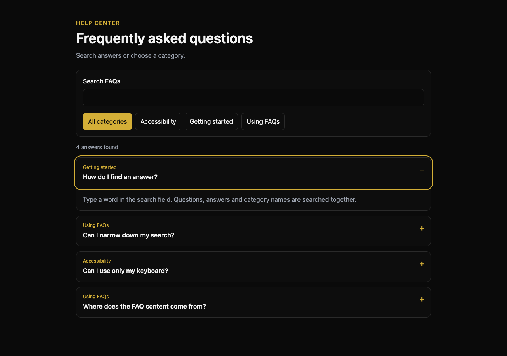
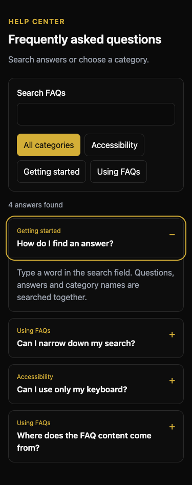

# Bounty 23 — FAQ Manager

A reusable, client-side React 19 / strict TypeScript component for the published bounty's **dynamic FAQ page, search, and category filters**. It uses the documented Agent Midas dark/gold Tailwind design tokens. No package manifest, lockfile, new production dependency, network call, or root configuration is introduced.

## Integration

```tsx
import { FAQManager, type FAQEntry } from './bounties/23-faq-manager';

const entries: FAQEntry[] = [
  { id: 'help-search', question: 'How do I search?', answer: 'Enter a word from a question or answer.', category: 'Using FAQs' },
];

<FAQManager entries={entries} />;
// Controlled loading/error states:
// <FAQManager entries={entries} loading={loading} error={error} onRetry={reload} />
```

- Supply published content through `entries`. Entries have stable, unique IDs within each collection. Update the array immutably to refresh results without remounting.
- Import from an existing React application with Tailwind 4 scanning this directory. All class names are static strings. React, React DOM, TypeScript and Tailwind are part of the stack documented in the repository README.
- Content is plain text, never HTML. The component neither stores FAQs in the browser nor sends them to a server. Persistence, publishing permissions and backend loading remain the host application's responsibility.
- Loading suppresses stale results and announces busy status. Errors use an alert and an optional explicit retry callback. Empty collections and unmatched searches have separate messages.
- Search combines normalized question, answer and category text with an exact category filter. A removed category automatically falls back to all categories.
- Native buttons support Tab/Enter/Space. Arrow Up/Down, Home and End navigate visible question buttons. Every `aria-controls` target remains in the DOM even when collapsed. Instance-scoped IDs permit multiple components on one page.
- No fabricated payment, account, security or production-platform claims are embedded in sample FAQs.

## Actual scope and limits

The default branch is a documentation-only programme repository, without an application scaffold. This is a standalone integration component, **not a deployed platform, database migration, admin CRUD system or verified production integration**. Its tests and screenshots use an isolated local harness. There is no claim that an existing bounty reservation has been granted or that other contributors' open submissions have been superseded.

## Validation

- Strict TypeScript typecheck: passed.
- Included Node test suite: **20 passed, 0 failed**.
- Real headless Chrome: server-rendered markup hydrated without console errors; combined category/search, no-results/reset, keyboard Home/End/Enter, valid ARIA targets, dark theme and no horizontal overflow verified at **1280 × 900** and **375 × 812**.
- Screenshots below are from the component with illustrative, generic FAQ content, not from the Agent Midas production application.
- No unexpected external requests occurred in the browser run.
- No maintainer pipeline, real screen-reader session or full WCAG audit has been claimed.

### Reproduce the isolated component tests

Keep all QA-only packages **outside this repository**. This does not add packages to the contribution or to the host application.

```sh
export QA_DIR="$(mktemp -d "${TMPDIR:-/tmp}/midas-faq-qa.XXXXXX")"
npm install --prefix "$QA_DIR" --ignore-scripts --no-audit --no-fund --package-lock=false \
  react@19 react-dom@19 esbuild@0.25 jsdom@26
FAQ_QA_DIR="$QA_DIR" NODE_PATH="$QA_DIR/node_modules" \
  node --test bounties/23-faq-manager/FAQManager.test.cjs
```

The committed tests compile the component into the external QA directory. Tests cover answer-text and Unicode search; combined filters and resets; a real category named `All categories`; persistent ARIA targets; independent expansion; multiple instances and unusual identifiers; keyboard navigation; controlled data refresh; empty/loading/error states; retry; text-only rendering of HTML-shaped input; and server rendering without browser globals. Use the host application's normal `tsc --noEmit` command for integration typechecking. This repository has no root `package.json` or `tsconfig.json`; the actual strict local harness result is recorded in `evidence/validation.json`.

## Review follow-up

Both CodeAnt-reported input edge cases were reproduced before changing production code (18 passing tests and 2 failing regressions), then fixed:

- Search folds dotted `İ` consistently in questions and queries, including canonically decomposed input, without removing unrelated accents.
- Instance-scoped DOM identifiers use fixed-width UTF-16 encoding instead of `encodeURIComponent`, so lone surrogates cannot crash rendering or keyboard focus and remain distinct from replacement characters and emoji.
- The expanded suite passes all 20 tests; strict TypeScript passes. Chrome desktop/mobile runs additionally verify dotted-I search, surrogate-ID server rendering/hydration, unique IDs, keyboard navigation and valid ARIA targets with no console errors or unexpected requests.
- Follow-up evidence: [test output](evidence/review-fix-tests.log), [validation](evidence/review-fix-validation.json), and [browser checks](evidence/review-fix-browser/browser-qa.json). The original validation timestamp, original test log and original screenshots below remain unchanged as historical evidence. The automated date warning used an incorrect current-date premise; the recorded original check date was not rewritten.

## Screenshots

### Desktop


### Mobile, 375px


## Contribution disclosure

Implementation, review, automated tests and browser checks were performed by an OpenAI-powered coding assistant acting for GitHub user `dssguitar1130-jpg`. The account owner has not been represented as performing an independent technical review. No accepted assignment, funded escrow, merged PR, payment eligibility or reward is asserted. The repository CLA and acceptance requirements must be addressed explicitly before a contribution can be accepted.
